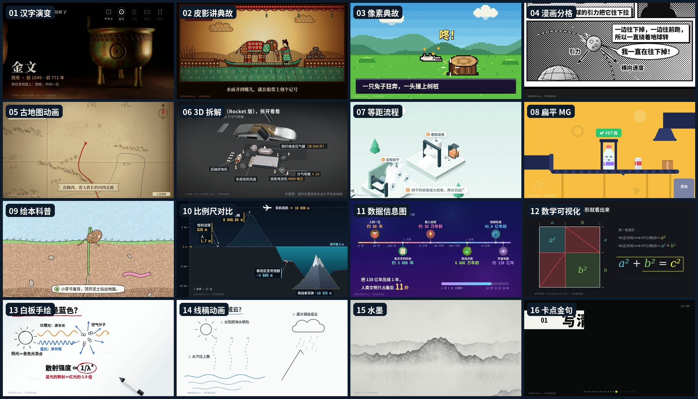

# code-video · 让大模型写代码，逐帧画出科普视频

[中文](#中文) · [English](#english)



## 中文

一个给 Claude Code / Cursor / Codex 等编码代理用的 **Agent Skill**：
不用任何视频生成模型，让大语言模型写网页代码（Canvas / SVG / Three.js / WebGL），
逐帧截图渲染成科普短视频。上图 16 段成片全是这样做出来的，没有一帧是拍的，也没有一帧是视频模型生成的。

**为什么用代码做视频**

- 文字、数字、公式、地名百分之百准确，想改哪句改哪句，改完重渲染就行。
- 每一帧只由时间 t 决定，可复现、可并行渲染、可以单独重渲某几帧。
- 零生成费用，不依赖任何视频模型的额度和排队。

**三步出片**

1. **挑画风**：画风跟着题材走（讲典故用皮影，讲路线用古地图，讲结构用 3D 拆解，讲多高多深用比例尺）。
2. **把提示词写细**：一句话只定了画风；还要写清讲什么、用哪些数据、每段几秒、哪些物理规则不能画错。
3. **先抽帧检查**：先截 4–6 帧给模型看，改好了再出全片。

**里面有什么**

| 目录 | 内容 |
|---|---|
| `SKILL.md` | 技能主文件：流程、页面合约、自检清单、命令 |
| `references/styles/` | 16 种画风：适合的题材、精简提示词、完整提示词、制作手记、事实依据 |
| `examples/` | 16 段示例成片的完整源码，可直接渲染 |
| `templates/canvas/` | 符合页面合约的最小起步模板 |
| `scripts/render.sh` | 并行确定性截帧 + 编码（自动选 NVENC 或 x264） |
| `scripts/tts.py` | 旁白 + 字幕，默认免费的 edge-tts，也能接自建 TTS |
| `scripts/mux.sh` | 合成旁白、配乐（自动避让人声）、字幕，响度归一 |
| `scripts/chiptune.py` / `beat.py` | 代码合成的芯片音乐、帧对齐的卡点鼓点（无版权问题） |
| `scripts/gif.sh` | 预览 GIF / 封面帧 |

**安装**

```bash
# Claude Code
git clone https://github.com/zizhongxiao-svg/code-video-skill ~/.claude/skills/code-video
# Cursor
git clone https://github.com/zizhongxiao-svg/code-video-skill ~/.cursor/skills/code-video

cd ~/.claude/skills/code-video   # 或对应目录
npm install
npx playwright-core install chromium-headless-shell
pip install edge-tts numpy scipy   # 可选：旁白、字幕、配乐
```

还需要 `ffmpeg` / `ffprobe`，以及中文字体（推荐 Noto Sans CJK：`apt install fonts-noto-cjk`）。

**试一下**

```bash
scripts/render.sh examples/piying 30,150,300   # 抽 3 帧看看 -> examples/_preview/piying/
scripts/render.sh examples/piying              # 渲染全片 -> examples/piying.mp4
```

然后对你的编码代理说：“用 code-video 做一段 12 秒的比例尺科普：马里亚纳海沟有多深”，
或者“用皮影风格讲一个成语故事”。

**注意**

- 示例里的事实和数字都写在各自的 `notes.txt` 里；换题材时请重新核对。
- edge-tts 是微软的在线服务，商用前请自行确认服务条款。配乐请用自己合成或明确授权的音乐。
- `3D 拆解` 示例里的新车结构是按公开报道画的示意图，不代表官方设计。

## English

An **Agent Skill** for coding agents (Claude Code, Cursor, Codex, ...) that makes explainer videos
**without any video-generation model**: the LLM writes a web page (Canvas / SVG / Three.js / WebGL)
that draws frame *t*, and a headless browser captures every frame deterministically before ffmpeg
encodes it. Every clip in the gallery above was made this way.

**Why code instead of a video model**: text, numbers and formulas are exact and editable; every frame
is a pure function of time, so renders are reproducible and parallel; it costs nothing per render.

**Workflow**: (1) pick a style that fits the topic, (2) write a detailed prompt — story beats, real data,
timing, and the physical rules that must not be drawn wrong, (3) sample a few frames, let the model
inspect them, fix, then render the full clip.

**Contents**: 16 styles with short and full prompts (`references/styles/`, in Chinese), full source of
all 16 example clips (`examples/`), a starter template, a parallel deterministic renderer with
NVENC/x264 auto-selection, free narration + subtitles via edge-tts (or any HTTP TTS server),
music/voice/subtitle muxing with ducking and loudness normalization, and code-synthesized
royalty-free chiptune and beat tracks.

**Install**

```bash
git clone https://github.com/zizhongxiao-svg/code-video-skill ~/.claude/skills/code-video
cd ~/.claude/skills/code-video && npm install && npx playwright-core install chromium-headless-shell
pip install edge-tts numpy scipy   # optional: narration, subtitles, music
```

Requires `ffmpeg`/`ffprobe` and a CJK font (e.g. Noto Sans CJK) for the Chinese examples.

```bash
scripts/render.sh examples/math 60,200,340   # preview frames
scripts/render.sh examples/math              # full clip -> examples/math.mp4
```

## License

MIT. three.js (downloaded on demand by `scripts/fetch_three.sh`) is MIT-licensed by its authors.
