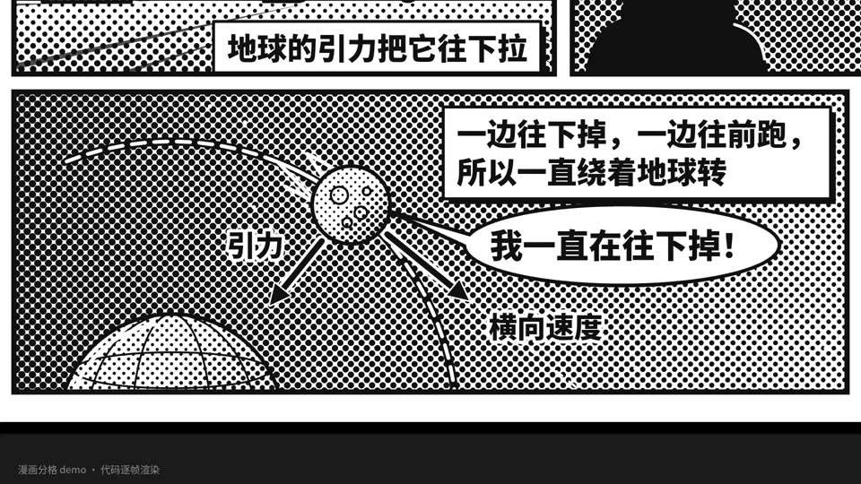

# 04 漫画分格 · Halftone comic panels

- **示例题材**：牛顿与苹果
- **适合**：一问一答式的科学故事
- **时长**：11 秒　**技术**：Canvas 2D
- **示例源码**：[`examples/comic/`](../../examples/comic/)



## 精简版提示词（复制就能出个大概）

```text
用 Canvas 做 11 秒五格漫画：黑白网点、粗描边，全片只有苹果和点题句用红色。
讲牛顿与苹果：苹果落地，月亮为什么不掉，山顶平射炮弹，月亮一直在往下掉，点题万有引力。
炮弹轨道按引力算，不给牛顿编台词；每帧只由 t 决定，先抽帧检查再出全片。
```

## 完整版提示词（示例成片就是用它跑出来的）

```text
用 Canvas 2D 逐帧绘制一段 1920×1080、30fps、约 11 秒的分格漫画：整页五格，黑白网点（halftone 圆点，按明暗改变点径）配黑色粗描边，全片只用一种红色，而且只给苹果和最后一句点题。
镜头在格间移动：逐格推近，每格停留约 1.5 秒读完再平移到下一格，最后拉远看整页；格内要有旁白框、对白或思考气泡、速度线和集中线，文字 ≥36px。
题材是牛顿与苹果：① 苹果落地，旁白“地球的引力把它往下拉”；② 夜空下牛顿的背影望着月亮，旁白“那月亮为什么不掉下来？”；③ 牛顿设想在山顶平射炮弹，用中心引力数值积分画出“越快落得越远、够快就绕地球一圈”的轨迹；④ 月亮沿轨道运动，标出横向速度和引力，月亮说“我一直在往下掉！”；⑤ 红字点题“拉苹果的力，也拉着月亮——万有引力”。
不要给牛顿编台词或名言，也不要画苹果砸头的传说。
所有动画只由时间 t 决定；先抽帧检查文字是否出格、气泡是否挡住关键图形，改完再全片渲染。
```

## 制作手记

画面是黑白网点，全片只有苹果和最后那句点题用了红色。第三格画的是牛顿那个“山顶开炮”的思想实验，炮弹轨道是按引力一步步算出来的，“越快飞得越远，够快就绕着转”是真轨迹。提示词里写了不给牛顿编台词、不画苹果砸头的传说。

## 事实依据（notes.txt）

苹果故事来自牛顿晚年对 William Stukeley 的口述（Stukeley 1752 年写成的《牛顿爵士生平回忆录》，并无“砸到头”）；山顶平射炮弹的思想实验出自牛顿《论宇宙体系》（A Treatise of the System of the World，1728 年出版），用同一种引力解释月球绕地运动见《自然哲学的数学原理》（1687）第三卷；画面轨迹按中心引力数值积分，速度以近地圆轨道速度为单位。
