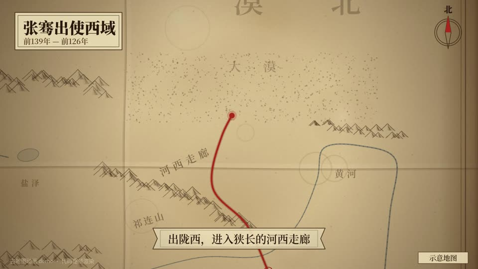

# 05 古地图动画 · Antique map journey

- **示例题材**：张骞出使西域
- **适合**：路线、出使、迁徙、战役
- **时长**：12 秒　**技术**：Canvas 2D
- **示例源码**：[`examples/oldmap/`](../../examples/oldmap/)



## 精简版提示词（复制就能出个大概）

```text
用 Canvas 做 12 秒古地图：羊皮纸底图、淡墨山脉，朱红路线随时间描出，镜头跟着路线走。
讲张骞出使西域：长安、河西走廊、被匈奴扣留、大宛、康居、大月氏，虚线画归途。
每站大字地名配一句讲解，右下角注“示意地图”；每帧只由 t 决定，先抽帧检查再出全片。
```

## 完整版提示词（示例成片就是用它跑出来的）

```text
用 Canvas 2D 做一段 12 秒的「古地图动画」：先离屏生成一张羊皮纸世界底图（斑驳水渍、颗粒、三折折痕、焦黄暗边、双线图框），在上面用淡墨画山脉符号、河流、沙漠点画和地名，朱红路线随时间描出；镜头以路线前端为中心、略微前瞻跟随，长途段稍微拉远，开头和结尾拉到全图，跟随时把镜头限制在地图范围内。
题材：张骞出使西域——长安（前139年前后出发）→ 陇西，进入河西走廊 → 被匈奴扣留十余年 → 大宛 → 康居 → 大月氏，最后用虚线画归途，前126年回到长安，「去时百余人，归来只剩两人」。
每到一站显示大字地名，底部卷轴条写一句讲解，关键年份盖朱红印章。
地图是示意图：按经纬度粗略投影，保证长安在东、葱岭和大宛在西、河西走廊西北向狭长，右下角注「示意地图」，地名顺序和年代以《史记·大宛列传》为准。
每帧只由 t 决定；抽帧检查地名是否压住路线、镜头是否露出地图外边、每句讲解是否停留 1 秒以上，再全片渲染。
```

## 制作手记

底图做成羊皮纸，山脉用淡墨，路线用朱红，镜头跟着路线的前端走，每到一站出大字地名和一句讲解。右下角标了“示意地图”，地名顺序按《史记·大宛列传》。每站只停一秒左右，所以每句讲解都得写得很短。

## 事实依据（notes.txt）

路线和事件依据《史记·大宛列传》（“出陇西，经匈奴，匈奴得之……留骞十余岁……西走数十日至大宛……大宛为发导绎，抵康居，康居传致大月氏……殊无报胡之心……骞初行时百余人，去十三岁，唯二人得还”），出发年采用常见的建元二年（前139年，另有前138年一说），归长安为元朔三年（前126年）；匈奴扣留地点、逃亡路径和归途（南道/羌中）均为示意，各地按现代经纬度粗略投影。
