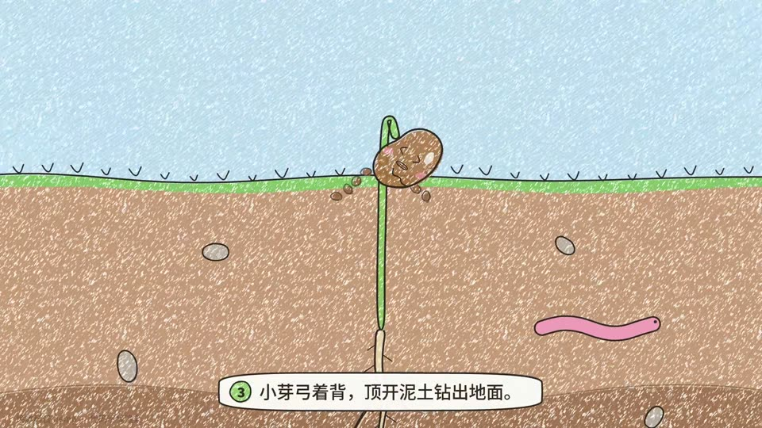

# 09 绘本科普 · Picture book (crayon)

- **示例题材**：一颗种子怎么长成大树
- **适合**：低龄科普、自然生长
- **时长**：12 秒　**技术**：Canvas 2D
- **示例源码**：[`examples/picturebook/`](../../examples/picturebook/)



## 精简版提示词（复制就能出个大概）

```text
用 Canvas 做 12 秒绘本：钢笔线每 3 帧轻微抖动，蜡笔涂色带颗粒和漏白，白纸底。
讲一颗种子怎么长成大树：喝水裂开、扎根、顶开泥土、长叶晒太阳、长成大树。
主角是有表情的小种子，每步一句童趣旁白；每帧只由 t 决定，先抽帧检查再出全片。
```

## 完整版提示词（示例成片就是用它跑出来的）

```text
用 Canvas 2D 做一段 12 秒、1920×1080、30fps 的「绘本科普」动画：深褐色钢笔线加蜡笔涂色，线条每 3 帧用固定种子换一组 1–2px 的小偏移（boiling lines），蜡笔色块由“底色 + 斜向排线 + 纸纹漏白颗粒”叠成，色块故意和线稿错开几像素留出白边，纸面用白色带细纤维的纸，不要米黄纸和衬线字。
题材是“一颗种子怎么长成大树”，画成地上天空、地下土壤的剖面图，主角是一颗有表情的小种子：①在土里睡觉，水滴渗下来，它喝饱水鼓起来、种皮裂开 ②根先钻出来往下扎，长出根毛 ③小芽弓着背顶开泥土，土块飞溅 ④种皮掉落、叶子张开晒太阳，用手绘箭头标出“阳光、二氧化碳、水、氧气” ⑤延时长成大树，脸转到树干上，最后掉下两颗新种子。
镜头从地下特写一路拉远到整棵树，每一步底部配一句童趣但准确的旁白字幕（如“根最先钻出来，一路往下找水喝”），白色手绘框、字号 ≥44px，表情随剧情变化：睡、惊讶、使劲、开心。
每一帧只由时间 t 决定（随机用固定种子），渲染后抽 6–8 帧检查：主角在画面里够大、标签不互相遮挡、字幕不盖住主角，线条确实在“抖”而不是乱跳。
```

## 制作手记

钢笔线每两三帧换一组微小偏移，看起来像手绘在抖；蜡笔涂色有颗粒和漏白。主角是个有表情的小种子，每一步配一句童趣旁白。颗粒每帧都在变，视频一压缩，这种画风最先糊，码率低的平台上更明显。

## 事实依据（notes.txt）

依据种子萌发的标准生物学过程：吸胀（种子吸水膨胀、种皮破裂）→胚根最先突破种皮并向地性向下生长、长出根毛→下胚轴弯成“顶端弯钩”护住子叶和顶芽顶出土面（子叶出土型萌发）→真叶展开进行光合作用（6CO2+6H2O→C6H12O6+6O2，需光照）→多年生长成树并结实，见人教版初中《生物学》七年级上册“种子的萌发”“绿色植物的光合作用”章节及 Raven《Biology of Plants》。
