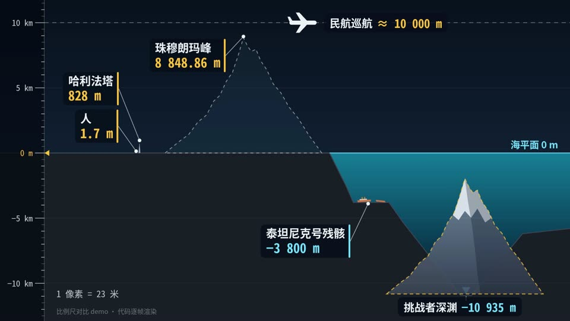

# 10 比例尺对比 · Scale comparison

- **示例题材**：马里亚纳海沟有多深
- **适合**：高度、深度、距离、体积
- **时长**：12 秒　**技术**：Canvas 2D
- **示例源码**：[`examples/scale/`](../../examples/scale/)



## 精简版提示词（复制就能出个大概）

```text
用 Canvas 做 12 秒比例尺对比：深蓝夜空、青蓝海水，左侧刻度尺随缩放自动换档。
讲马里亚纳海沟有多深：人、哈利法塔、珠峰、飞机、挑战者深渊同一比例，镜头逐级拉远。
结尾把珠峰放进海沟，数字来源写进 notes.txt；每帧只由 t 决定，先抽帧检查再出全片。
```

## 完整版提示词（示例成片就是用它跑出来的）

```text
做一段 12 秒、1920×1080、30fps 的「比例尺对比」科普动画，用 Canvas 逐帧绘制：深蓝夜空 + 青蓝渐变海水 + 炭灰地层的干净配色，左侧一根随缩放自动换档的刻度尺，等宽字体大数字，标签是深色圆角卡片加细引线。
题材是“马里亚纳海沟有多深”：以海平面为零线，往上依次摆人（1.7 m）、哈利法塔（828 m）、珠穆朗玛峰（8848.86 m）、民航巡航高度（约 10 000 m），往下摆泰坦尼克号残骸（约 3800 m）和挑战者深渊（10 935 m），所有物体用同一比例尺。
镜头从人开始，按对数插值缩放逐级拉远（人 → 哈利法塔 → 珠峰和飞机 → 整个海洋剖面），每到一级弹出该物体的名称和数字，左下角实时显示“1 像素 = 多少米”。
结尾把珠峰整座搬进海沟，原位留虚线轮廓，用括号量出峰顶到海面的距离，并打出“把珠峰放进海沟，峰顶离海面还有约 2 公里”和算式 10 935 − 8 848.86 ≈ 2 086 m。
每帧只由时间 t 决定；先抽 4–6 帧检查标签有没有重叠、出画或看不清，至少改一轮再全片渲染，所有数字和 notes.txt 中的来源一致。
```

## 制作手记

镜头从一个人拉到整个海洋剖面，左边刻度尺自动换档，左下角实时显示一像素等于多少米。挑战者深渊取 10935 米。各次公开测量差了一百来米，所以结尾把珠峰放进海沟时只说“峰顶离海面还有约 2 公里”，按哪次测量算都成立。

## 事实依据（notes.txt）

数据来源：珠峰 8848.86 m（2020 年中尼联合测量公布值）；哈利法塔 828 m（CTBUH 建筑高度）；泰坦尼克号残骸约 3800 m（NOAA：约 12,500 英尺 ≈ 3810 m）；民航巡航高度一般 9–12 km，取约 10 000 m；人取成年人约 1.7 m；挑战者深渊取 10 935 m（Greenaway et al. 2021，10 935 ± 6 m），不同年代的公开测量值约在 10 902–10 994 m 之间（如 2010 年 UNH-CCOM 多波束 10 994 ± 40 m、2019 年 Vescovo 下潜 10 925 m）。
结尾算式：10 935 − 8 848.86 = 2 086.14 m ≈ 2 公里（取测量范围两端也在约 2.05–2.15 km 之间）。
画法说明：哈利法塔、珠峰、海沟深度按同一比例尺真实绘制；人、飞机、残骸在远景中按固定大小图标标出真实高度/深度位置；海底剖面是示意，泰坦尼克号（北大西洋）与马里亚纳海沟（西太平洋）是为对比并排摆放。
