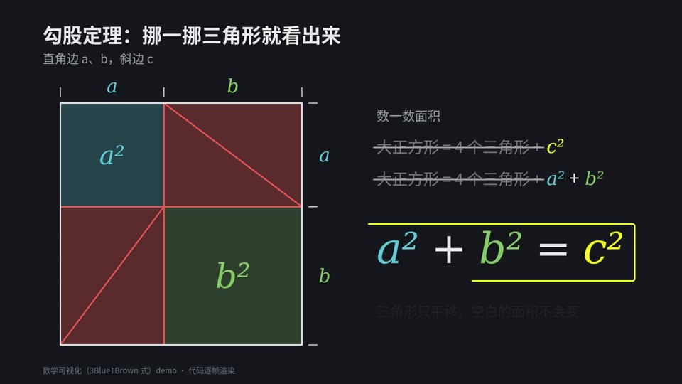

# 12 数学可视化 · 3Blue1Brown-style math

- **示例题材**：勾股定理的拼图证明
- **适合**：定理、公式推导
- **时长**：12 秒　**技术**：SVG
- **示例源码**：[`examples/math/`](../../examples/math/)



## 精简版提示词（复制就能出个大概）

```text
用 SVG 做 12 秒 3Blue1Brown 式动画：深色底，蓝绿黄红四色，图形先描边再填充。
证明勾股定理：四个三角形只平移不旋转，空出 a² 和 b²，右边同步列面积账。
最后定格 a² + b² = c²；每帧只由 t 决定，先抽帧检查再出全片。
```

## 完整版提示词（示例成片就是用它跑出来的）

```text
用 3Blue1Brown 式数学可视化风格做一段 12 秒、1920×1080、30fps 的 SVG 动画：深色底（#16181d）、干净的几何线条，图形先描边再填充，颜色固定用 #58C4DD 蓝、#83C167 绿、#FFFF00 黄、#FC6255 红，字母用斜体衬线、中文用 Noto Sans CJK SC。
内容是勾股定理的拼图证明：左边画边长 a+b 的大正方形（a:b=3:4，上边和右边标 a、b），四个红色半透明直角三角形依次描边入场，中间空出的斜放正方形填黄并标 c²。
随后三个三角形只做平移（不旋转）、一个一个挪到新位置，空出的区域变成蓝色 a² 和绿色 b² 两个正方形。
右侧面积账逐行出现：「大正方形 = 4 个三角形 + c²」「大正方形 = 4 个三角形 + a² + b²」，相同部分划掉变暗，再逐项弹出大号 a² + b² = c²，黄框描边定格至少 0.8 秒。
所有动画只由时间 t 决定（window.__render(t)），不用 CSS 动画或随机数；做完抽 4–6 帧检查文字重叠、三角形平移后是否严丝合缝、正文字号 ≥ 36px。
```

## 制作手记

深色底和配色学的是 3Blue1Brown。四个三角形留一个不动，另外三个只平移、不旋转，挪到新位置后正好空出 a² 和 b²；右边同时列出两种摆法的面积，把相同的四个三角形划掉，最后剩下 a² + b² = c²，画面停在这里。动作偏朴素，没用上 3Blue1Brown 常用的那种图形连续变形过渡。

## 事实依据（notes.txt）

依据：勾股定理的经典“重排证明”（见于《周髀算经》弦图思路及 Wikipedia “Pythagorean theorem – Rearrangement proof”）：边长 a+b 的正方形减去 4 个全等直角三角形，一种摆法剩 c²，另一种剩 a²+b²，故 a²+b²=c²；画面 a:b 取 3:4（对应 3-4-5 三角形），四个三角形在两种摆法间只做平移，坐标已逐个核对。
