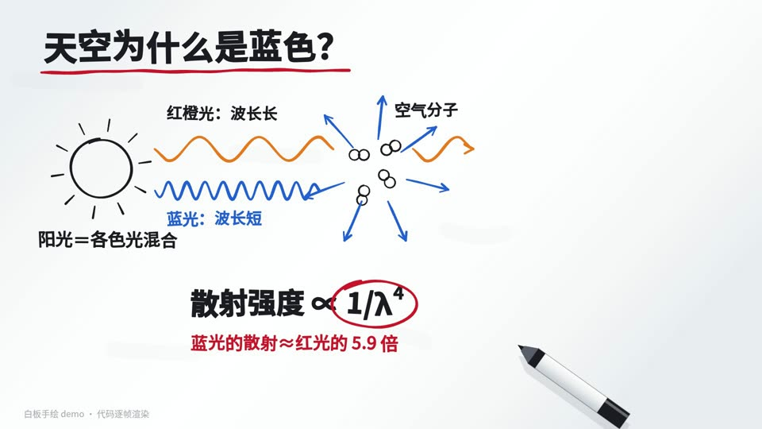

# 13 白板手绘 · Whiteboard sketch

- **示例题材**：天空为什么是蓝色
- **适合**：单个原理、因果解释
- **时长**：12 秒　**技术**：Canvas 2D
- **示例源码**：[`examples/whiteboard/`](../../examples/whiteboard/)



## 精简版提示词（复制就能出个大概）

```text
用 Canvas 做 12 秒白板手绘：马克笔逐笔画、文字逐字写出，笔尖跟着笔画走，红笔只圈重点。
讲天空为什么是蓝色：蓝光散射更强（约是红光的 5.9 倍），日落时光路长，只剩红橙。
数字按公式算对；每帧只由 t 决定，先抽帧检查再出全片。
```

## 完整版提示词（示例成片就是用它跑出来的）

```text
用 Canvas 2D 逐帧绘制一段 12 秒、1920×1080、30fps 的「白板手绘」科普动画：白底加极淡的斜向白板反光，黑色马克笔逐笔画出线条（按笔画累计长度截取，线宽随弧长轻微起伏、起笔略细），文字逐字以斜向擦除方式“写”出来，每个字带一点旋转和高低错落，一支马克笔的笔尖始终跟着当前笔画的终点走，换笔时抬起移过去。
红色马克笔只用于强调（标题下划线、圈出公式、标注括号），蓝色马克笔画蓝光，橙色马克笔画红橙光。
内容：天空为什么是蓝色——阳光里混着各种颜色 → 空气分子把波长短的蓝光散射得更厉害（散射强度 ∝ 1/λ⁴，450nm 蓝光约是 700nm 红光的 5.9 倍）→ 抬头时四面八方都是散射来的蓝光；然后镜头横移到第二块白板，画地球弧线和大气层，对比正午路短、日落路长（空气路程可达正午的约 38 倍），蓝光半路被散射掉，剩下红橙。
每帧画面只由时间 t 决定（不用 requestAnimationFrame 和 Math.random，随机数用固定种子），正文字号 ≥36px。
先抽 4–6 帧检查文字是否重叠、箭头是否压字、笔是否挡住关键内容、最后一帧笔是否已移出画面，改完再全片渲染。
```

## 制作手记

笔画粗细随长度起伏，文字逐字写出，一支马克笔跟着笔画走；红笔只用来圈重点。屏幕上写的“蓝光散射约是红光的 5.9 倍”，是按散射强度与波长四次方成反比、450 纳米对 700 纳米算的。字还是电脑字加抖动，不像真手写。

## 事实依据（notes.txt）

瑞利散射强度与波长的 4 次方成反比（I ∝ 1/λ⁴，见 Bohren & Huffman《Absorption and Scattering of Light by Small Particles》），按 450nm 与 700nm 计算 (700/450)⁴ ≈ 5.86；地平线方向的大气质量约为天顶的 38 倍（Kasten & Young 1989 大气质量公式在天顶角 90° 时的值）；画面中的分子、波形、地球与大气层比例都是示意。
