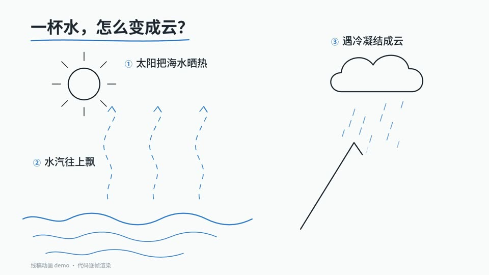

# 14 线稿动画 · Line-art animation

- **示例题材**：一杯水怎么变成云
- **适合**：概念串讲、循环过程
- **时长**：15.5 秒　**技术**：SVG
- **示例源码**：[`examples/lineart/`](../../examples/lineart/)



## 精简版提示词（复制就能出个大概）

```text
做一个线稿动画，讲清水循环：一杯水怎么变成云。白底墨线，水用一种蓝色；
太阳、海、上升的水汽、云、雨、山、河流依次一笔笔画出来，每一步配一句短标签。
所有动画只由 __render(t) 里的时间 t 决定，不用计时器和 CSS 动画。先给我关键帧截图。
```

## 完整版提示词（示例成片就是用它跑出来的）

```text
做一个线稿动画，讲清水循环：一杯水怎么变成云。白底墨线，水用一种蓝色；
太阳、海、上升的水汽、云、雨、山、河流依次一笔笔画出来，每一步配一句短标签。
所有动画只由 __render(t) 里的时间 t 决定，不用计时器和 CSS 动画。先给我关键帧截图。
```

## 制作手记

上一篇演示过的线稿，这次放进来做对照：白底墨线，太阳、水汽、云、雨、山一笔笔画出来，每步一句短标签。和白板比，线稿更安静，适合不需要强调的概念串讲。
