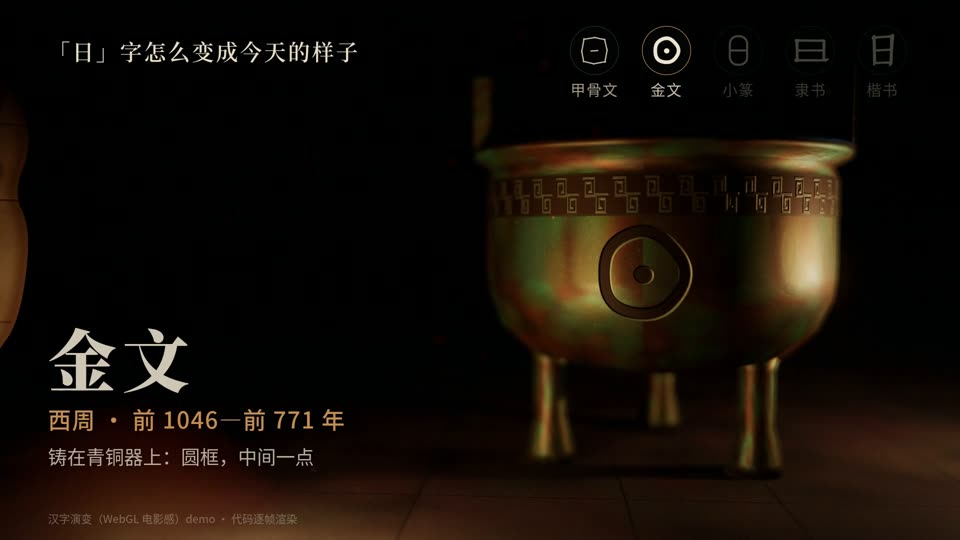
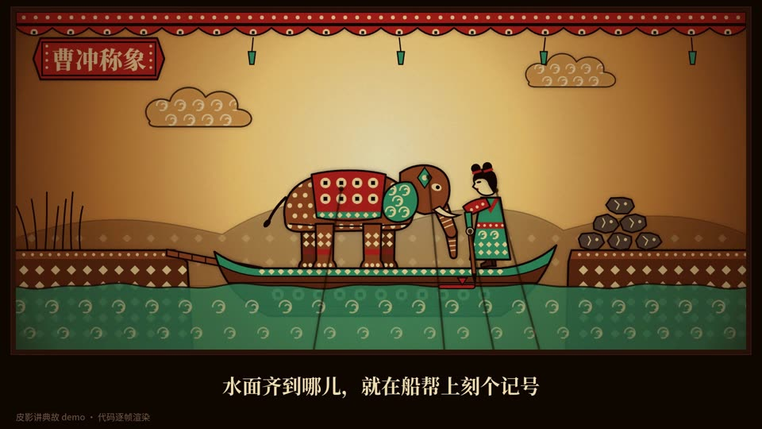
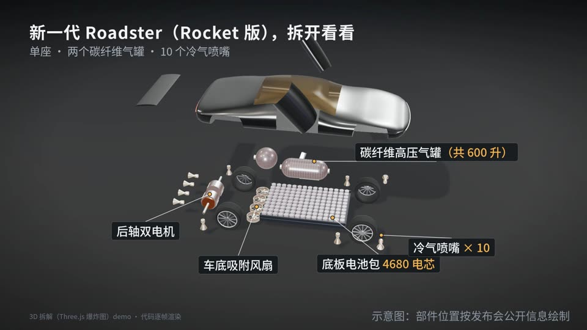
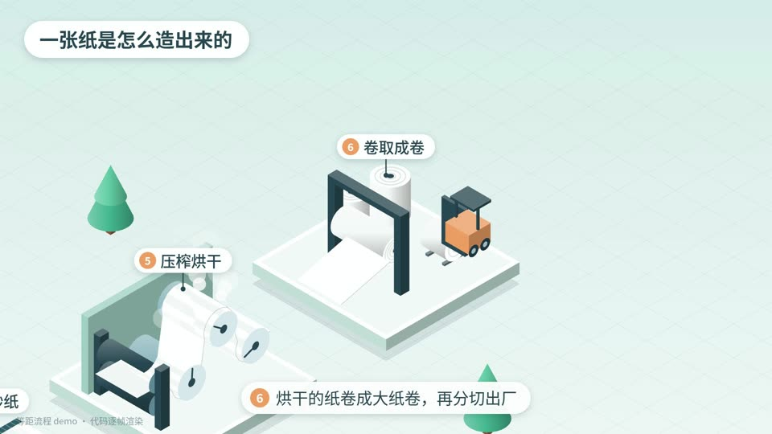
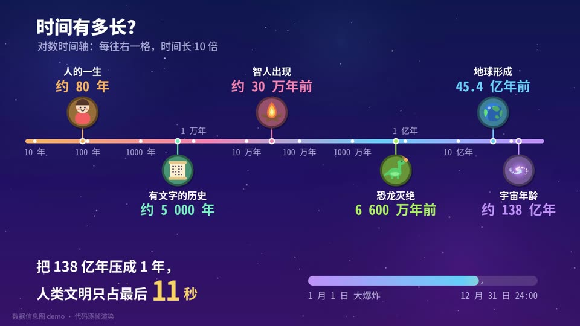

# 16 种画风索引 · Style catalog

每个文件包含：适合的题材、精简提示词（约 100 字，复制就能出个大概）、完整提示词（示例成片就是用它跑出来的）、制作手记（踩过的坑和不足）、事实依据。示例源码在 `examples/<name>/`，可以直接 `scripts/render.sh examples/<name>` 渲染。

## 历史与典故

| # | 画风 | Style | 示例题材 | 适合 | 技术 |
|---|---|---|---|---|---|
| 01 | [汉字演变](01-hanzi.md) | Chinese character evolution (3D) | 「日」字怎么变成今天的样子 | 文字、器物、朝代更替 | Three.js (WebGL) |
| 02 | [皮影讲典故](02-piying.md) | Shadow puppet (皮影) | 曹冲称象 | 成语、典故、历史小故事 | Canvas 2D |
| 03 | [像素典故](03-pixel.md) | 16-bit pixel art | 守株待兔 | 寓言、梗、游戏化叙事 | Canvas 2D |
| 04 | [漫画分格](04-comic.md) | Halftone comic panels | 牛顿与苹果 | 一问一答式的科学故事 | Canvas 2D |
| 05 | [古地图动画](05-oldmap.md) | Antique map journey | 张骞出使西域 | 路线、出使、迁徙、战役 | Canvas 2D |

## 结构与工序

| # | 画风 | Style | 示例题材 | 适合 | 技术 |
|---|---|---|---|---|---|
| 06 | [3D 拆解](06-explode3d.md) | 3D exploded view | 新 Roadster 是怎么飞起来的 | 机械结构、产品拆解、热门新品 | Three.js (WebGL) |
| 07 | [等距流程](07-isometric.md) | Isometric process | 一张纸是怎么造出来的 | 生产线、工序、供应链 | Canvas 2D |
| 08 | [扁平 MG](08-flatmg.md) | Flat motion graphics | 一个塑料瓶的回收之旅 | 循环流程、生活科普 | Canvas 2D |
| 09 | [绘本科普](09-picturebook.md) | Picture book (crayon) | 一颗种子怎么长成大树 | 低龄科普、自然生长 | Canvas 2D |

## 数字与公式

| # | 画风 | Style | 示例题材 | 适合 | 技术 |
|---|---|---|---|---|---|
| 10 | [比例尺对比](10-scale.md) | Scale comparison | 马里亚纳海沟有多深 | 高度、深度、距离、体积 | Canvas 2D |
| 11 | [数据信息图](11-infographic.md) | Kurzgesagt-style infographic | 时间有多长 | 年代、数量级、宏大尺度 | Canvas 2D |
| 12 | [数学可视化](12-math.md) | 3Blue1Brown-style math | 勾股定理的拼图证明 | 定理、公式推导 | SVG |

## 道理与气氛

| # | 画风 | Style | 示例题材 | 适合 | 技术 |
|---|---|---|---|---|---|
| 13 | [白板手绘](13-whiteboard.md) | Whiteboard sketch | 天空为什么是蓝色 | 单个原理、因果解释 | Canvas 2D |
| 14 | [线稿动画](14-lineart.md) | Line-art animation | 一杯水怎么变成云 | 概念串讲、循环过程 | SVG |
| 15 | [水墨](15-ink.md) | Chinese ink wash | 一滴墨为什么会晕开 | 传统文化、意境、慢节奏 | WebGL shader |
| 16 | [卡点金句](16-kinetic.md) | Kinetic typography (beat-synced) | 没有一帧是拍的 | 口号、金句、片头片尾 | Canvas 2D |

## 预览

| | | | |
|---|---|---|---|
|  01 汉字演变 |  02 皮影讲典故 |  03 像素典故 |  04 漫画分格 |
|  05 古地图动画 |  06 3D 拆解 |  07 等距流程 |  08 扁平 MG |
|  09 绘本科普 |  10 比例尺对比 |  11 数据信息图 |  12 数学可视化 |
|  13 白板手绘 |  14 线稿动画 |  15 水墨 |  16 卡点金句 |
